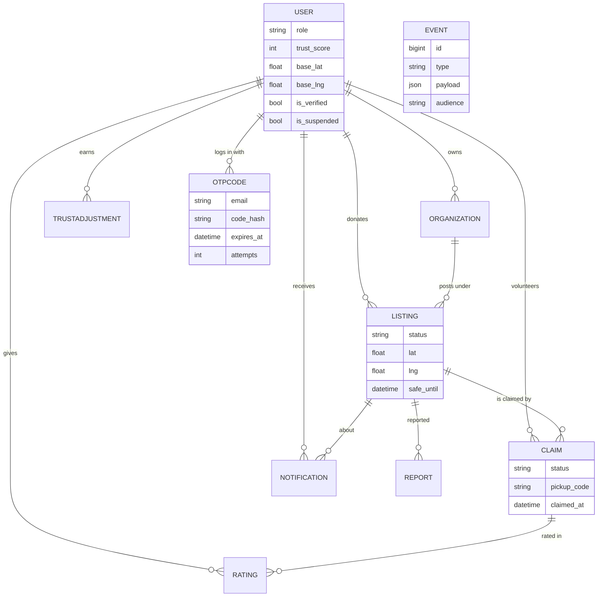

# FoodBridge — Final Project Report

*Live surplus-food rescue network, launched Vaniyambadi-first (Tamil Nadu), reusable for any town via environment variables.*

---

## Pre-production hardening round (latest)

This round closed the gap between "works in dev" and "works in production":

1. **OTP email root cause found and fixed.** The delivery call was gated behind `DEBUG or not RESEND_API_KEY` — with `DEBUG=True` (or an unset key) **no provider request was ever made**; the code was only printed to the server console. The pipeline is now: request path writes a durable `EmailOutbox` row (status `pending`), a worker claims it atomically and delivers via Resend whenever a key is configured (regardless of DEBUG), recording `accepted` (with provider message id) or `failed` (categorized: `auth_error` / `validation_error` / `rate_limited` / `network_error`). Retries run via `python manage.py process_email_outbox` (cron-able) up to 5 attempts. A restart can no longer lose a send.
2. **Delivery status UI.** `GET /api/v1/auth/otp/status/` exposes the outcome (never the code); the login screen shows "Sending verification code…" → "Verification email accepted for delivery — check your inbox (and spam folder)." → "Email delivery failed. Retry." Console provider (no key configured) is reported as accepted-with-provider=console so dev never pretends an email was sent.
3. **Email smoke test** (server-side only): `python manage.py send_test_email --to you@gmail.com --wait --real`.
4. **Dashboard shell rebuilt** as one CSS Grid (`260px sidebar | top bar / content`, `min-h-0` guards, independent scroll regions). Feed and map now start on the same line; the header never overlaps content; the removed `mx-auto`/`ml-60` conflict was the root cause of the misalignment.
5. **Map fixes**: `ResizeObserver → invalidateSize()` (tiles realign after viewport/panel changes), attribution reduced to "© OpenStreetMap contributors" via `setPrefix(false)` (OSM credit retained and clickable).
6. **Mobile List/Map switch** added; a real bug it caught: the map rendered 0-height in the mobile switch (auto-height box) — fixed with an explicit mobile height.
7. **S3 photo storage** (env-driven django-storages): local disk when unconfigured, private S3 bucket with signed URLs when configured; uploads validated (JPEG/PNG only, ≤5 MB), re-encoded to strip EXIF/GPS; local dev workflows unchanged.
8. **PostGIS benchmark**: measured, not guessed — see §"PostGIS decision" below. Haversine retained.

**Real provider test outcome:** with `RESEND_API_KEY` unset in this environment, real Gmail delivery could **not** be verified — honest status: provider-acceptance verified via mocked HTTP responses + the console provider; external configuration required for real delivery is documented in §11 (key + verified domain + SPF/DKIM).

**PostGIS decision:** benchmarked with `python manage.py benchmark_geo_feed --volumes 500 2000 10000 30000` — median feed query stayed at **1.0–1.4 ms** from 500 to 30,000 rows, with the planner moving to the composite `(status, lat, lng)` index scan as the table grows. **Haversine retained**; revisit PostGIS around ~100k+ listings or heavy multi-user geo queries.

---

## Global UI layout, card decoration and guided-tour repair (latest round)

A targeted UI-repair pass (no backend, API, design-system or functionality changes):

1. **Circular card decorations removed (root cause).** Every `.ticket` card carried a `.ticket-notch` — an absolutely-positioned circle at the top-left (`-top-2 left-6`) styled in `index.css` and stamped via 33 `<span className="ticket-notch">` elements across 16 components. The CSS rule was deleted and all spans removed; the perforation line, card backgrounds, borders, shadows and radii are untouched. No `.ticket-notch` remains anywhere (regression-tested).
2. **Guided tour buried by the Leaflet map (root cause + architecture).** Leaflet's internal panes use z-index 400–1000 inside a `.leaflet-container` that had `z-index: auto` — no stacking context — so the panes escaped into the root stacking context and painted over the fixed tour card (`z-70/71`). Two-level fix: (a) `.leaflet-container { z-index: 0 }` makes every map its own stacking context, (b) the tour's spotlight + tooltip now render through `createPortal` into `document.body` at the documented layers 9000/9100 (numbers, not CSS `var()` — React's CSSOM setter silently drops `var()` on `style.zIndex`). Verified by hit-test (`elementFromPoint` at the card/map overlap lands on the tour card) and screenshots.
3. **Explicit z-index hierarchy** documented in `index.css`: app content 1 · chrome 100 · Leaflet panes 400+ (contained per-map) · popovers 500 · modals 2000 · tour backdrop 9000 · tour card 9100 · toasts/confetti 9999.
4. **Tour tooltip placement made collision-aware with a measured card.** The card's real height is read via `ResizeObserver` (previously a 250 px estimate), so below/above/right/left placement with viewport clamping never clips at the bottom; the rAF loop keeps spotlight and card synchronized through scroll, resize and browser zoom; mobile keeps the bottom sheet. All tour features preserved (Next/Back/Skip, progress dots, cross-page "Take me there", per-role persistence, restart from Help).
5. **Help welcome panel layout.** The quick-actions card is now a wrap-friendly flex column→row: label left and buttons beside it, vertically centered on desktop; wrapping on tablet; stacked full-width buttons on mobile with `whitespace-nowrap` so button labels never fold into two lines; `min-w-0`/border-box throughout — nothing escapes the card at 1440/768/360 px (asserted in tests).
6. **Dark-mode button contrast (root cause).** `btn-primary`'s dark variant was `pantry-950` text on `forest-500` — ≈3.7:1, failing WCAG for small text (this is what the dark-mode screenshots showed as "dark text on green"). Dark variant moved to `forest-400` (≈6.5:1), and the same pattern was aligned on the sidebar active item, admin tabs, onboarding rail and workflow chips. Light mode unchanged (cream on forest-700).
7. **Responsive fixes from a 98-combination sweep** (14 pages × 7 viewports — 1920×1080, 1495×723, 1440×900, 1024×768, 768×1024, 390×844, 360×800 — with programmatic horizontal-overflow and element-escape detection): the landing hero's `whitespace-nowrap` accent forced a ~520 px grid column that clipped the whole hero below 390 px (now wraps on mobile, `text-4xl` up to `sm`), the header CTA hides below `sm` so the brand never truncates, and the admin console's three-tab row now wraps at 360 px. Final sweep: **zero genuine overflow flags** (the landing ticker's marquee spans are decorative, clipped, and `aria-hidden`).
8. **Impact empty state** keeps its truthful zero-data message; the CTA uses the established `btn-primary h-11 px-6` (contrast verified computationally in both themes); no fabricated numbers.
9. **Tests.** New `e2e/ui-regression.spec.ts` (12 tests: panel containment at three widths, nav wrapping, decoration absence on four routes, tour-above-map hit-test, viewport containment across all 9 volunteer steps at 1024×768, step-2/step-6 behaviour, Next/Back/Skip persistence, mid-tour resize, mobile bottom sheet, Leaflet controls + attribution during the tour, Impact zero state, dark-mode contrast) — runs against the **production preview** via `playwright.ui.config.ts` (`UI_REGRESSION=1` scopes it; the default config skips it). **UI regression 12/12 passed; existing suite 31/31 passed** in single runs; strict tsc, eslint 0 warnings, production build clean. Before/after/final evidence: `docs/screenshots/ui-repair/{before,final}/`.
10. **Environment notes (honest).** Several full-suite reruns failed from *local resource exhaustion* — the dev backend's SSE threads wedged under ~100 rapid page loads, the e2e backend died mid-run (ECONNREFUSED), and the login endpoint throttled rapid sweep logins — none of which are application defects: the identical suites passed cleanly when the machine had headroom (31/31 + 12/12 above). The responsive-sweep harness (`frontend/scripts/sweep-responsive.cjs`) is kept as a tool; its flaky long-session timeouts were shown to be environmental by reproducing the exact failing sequence successfully in isolation. Login throttling was never altered for tests.

---

## Global button spacing and interaction design audit (latest round)

1. **Root cause of the cramped buttons (Post Food Cancel/Next and friends).** The shared `.btn` base class in `index.css` defined layout (`inline-flex items-center justify-center gap-2 rounded-xl font-semibold …`) but **no default padding and no height**. Every usage that didn't add explicit `h-*`/`px-*` utilities rendered with zero internal padding — text and icons touching the borders. Bare usages existed on the Post Food wizard (Cancel/Next), the Post gate links, the volunteer empty-state buttons, the feed Filters button, My rescues/listings CTAs and the admin user-table actions.
2. **Design tokens (one fix, all variants).** The `.btn` base now carries the shared metrics: `px-5 py-2.5` (≈44 px tall at text-base, ≈40 px at text-sm — matching the 44 px standard / 36–40 px compact targets), the existing `gap-2` as the 8 px icon/label gap, and `.btn > svg { flex-shrink: 0 }` so icons never collapse and labels never get squeezed. Per-usage utilities (`h-9 h-10 h-12 h-14 px-3 px-4 px-6 p-0 w-full`) still override the defaults, so compact, large and icon-only buttons keep their designed sizes; icon-only controls keep their fixed `40×40` squares with centered icons. No global overrides outside the component layer.
3. **Post Food wizard** — Cancel/Back and Next (and Post it) now render with comfortable padding, vertically centered content, fully visible borders, Cancel left / primary right in the same row across all three steps; food-type chips, Veg/Non-veg selectors and one-tap location buttons verified in dark and light.
4. **Verification.** Before/after screenshots for the wizard (3 steps × dark/light), My listings, My rescues and mobile: `docs/screenshots/button-audit/{before,after}/`. Five new Playwright tests (in `ui-regression.spec.ts`, production-preview config) assert computed padding ≥14 px, heights ≥40 px, no vertical clipping (`scrollHeight ≤ clientHeight`), left/right row alignment, icon-only squareness/centering, mobile action-group containment at 390 px, and light/dark text contrast (`rgb(250,246,236)` on `rgb(35,88,63)` light; `rgb(21,16,9)` on `rgb(93,166,125)` dark). **UI regression 17/17 passed; existing regression 31/31 passed** (single runs; dev stack paused during the e2e run and restored after, per the resource recipe). Strict tsc, eslint 0 warnings, production build clean.
5. **Remaining inconsistencies (deliberate, documented).** Chips/tags keep their compact `py-0.5–1.5` scale (they're selectors, not action buttons); the segmented List/Map switch keeps its custom pill style; step number circles and status chips are indicators, not buttons. All other controls inherit the shared token base.

---

## Zero-cost staging deployment readiness (latest round)

Repository prepared for a **$0/month** staging stack — **Vercel Hobby** (frontend) + **Render Free** (backend web service) + **Neon Free** (PostgreSQL **and** photo storage) + **Resend Free** (OTP) + **cron-job.org** (hourly maintenance). Deployment is **manual**; nothing was deployed and no payment method was attached anywhere.

1. **Storage switched from Cloudflare R2 to Neon Object Storage (investigated first).** Verified against Neon's S3-compatibility documentation: presigned GET/PUT supported (SigV4 only, configurable expiry), PutObject/GetObject/HeadObject/DeleteObject (soft delete) supported, multipart + CopyObject supported; **path-style addressing required** (virtual-hosted unsupported); **ACL writes on the wire return 501** (buckets are private by default with public access blocked); 5 GB free per project, branch-aware namespaces. Every existing photo-workflow requirement (private bucket, upload, signed download, delete, URL generation, EXIF strip before upload, persistence) is satisfiable — no incompatibility requiring a stop.
2. **One code adaptation, tested.** `config/storage.py::default_storage_config` now emits two shapes: AWS (unchanged — virtual-hosted, `x-amz-acl: private`) and S3-compatible endpoints (Neon, MinIO…): `addressing_style: "path"` set automatically when an endpoint URL is present, **no ACL parameter sent**, `custom_domain` unset so presigned URLs hit the provider endpoint. Env overrides: `AWS_S3_DEFAULT_ACL`, `AWS_S3_ADDRESSING_STYLE`. Tests: `test_neon_object_storage_config_selected_when_endpoint_set`, `test_acl_override_still_possible_via_env` added; the AWS selection test is unchanged and passing. **Full backend suite 121/121.**
3. **Render hours math enforced in the blueprint.** `render.yaml` (new) defines the free web service (single Uvicorn worker, 512 MB, health check `/api/v1/config/`, `sync:false` secrets). A free background worker for outbox recovery is included **commented out**: Render's 750 free instance-hours are shared, and a second always-on service (~720 h) could exceed them → automatic suspension. Outbox recovery defaults to cron-job.org calling the secured process endpoint hourly (which also wakes the sleeping service). Render Cron Jobs are a paid feature — not used.
4. **Vercel**: `frontend/vercel.json` (SPA rewrite + security headers) already in place; Hobby is for personal/non-commercial use, which staging satisfies; free `*.vercel.app` domain, no domain purchase. `VITE_API_URL` points at the Render service; CORS/`FRONTEND_URL` on Render must list the exact Vercel domain.
5. **Resend (unchanged integration)**: sandbox sender delivers only to the account owner — OTP emails reach the owner (`vikashvnb2005@gmail.com`); **other users' addresses will not receive OTP until a domain is verified** (documented; not auto-purchased). Password login remains fully available; the UI reports delivery state from the outbox honestly. Immediate post-commit delivery kept; cron + worker only recover failures.
6. **Deployment guide rewritten** (`DEPLOYMENT.md`): provider-by-provider manual steps (Neon DB + bucket + storage credential, Render Blueprint, Vercel import, cron setup), the full env-var tables, the free-allowance/exhaustion audit ($0/month table), the manual verification checklist (what is verified locally vs. what needs the live accounts), and the optional data-migration path.

---

## Branded transactional email (latest round)

The OTP email was upgraded from plain text to a professional branded HTML email with a plain-text alternative.

1. **Design.** Table-based, 560 px, inline CSS, no JS/external stylesheets/remote images — renders in Gmail desktop/mobile and legacy clients. Warm cream background (#F5F1E7), forest-green header bar (#205C43) with the FoodBridge wordmark and saffron accent bar (#E39A17), serif heading ("Verify your email"), the six-digit code in a saffron-tinted panel with large letter-spaced typography, a "expires in 5 minutes" note, a security note ("Never share this verification code…"), and a branded footer with the tagline "Reducing food waste. Sharing goodness." and © 2026 FoodBridge. A hidden preheader improves inbox previews.
2. **Templates.** `backend/accounts/templates/accounts/emails/otp_email.html` (branded HTML) and `otp_email.txt` (plain-text alternative with identical content). Rendered via Django's template engine; the only dynamic values are the generated digit code and the expiry duration — template autoescaping is active, and there are no user-supplied strings in the email.
3. **Resend payload.** `accounts/otp.py::_render_provider_request` sends `html` + `text` alternatives alongside `from`/`to`/`subject`. The sender display name is always "FoodBridge": `accounts/otp.py::_sender_header()` prepends it when `OTP_EMAIL_FROM` is a bare address, and keeps a full header (`FoodBridge <otp@mail.yourdomain.com>`) as-is.
4. **Sender configuration.** `OTP_EMAIL_FROM` is configurable via `.env`. Custom addresses (`otp@mail.yourdomain.com`) require the domain to be verified in Resend (SPF/DKIM records); the sandbox (`onboarding@resend.dev`) delivers only to the account owner.
5. **Security.** All existing protections unchanged: hashed OtpCode storage, 5-min expiry, 5 attempts, 30 s cooldown, dev_code never returned when Resend is configured, no OTP in logs/tracking URLs, EmailOutbox retry preserved. The outbox stores both rendered bodies (the retry worker's requirement) — at-rest encryption of the outbox body is a documented follow-up.
6. **Real-provider verified.** `send_test_email --real` with the branded template: Resend accepted with `provider_status_code=200` and message id recorded; both HTML (5.9 KB) and text (443 B) persisted in the outbox row.

---

## User onboarding, product education and guided experience (latest round)

Goal: a completely new user can understand FoodBridge and complete their first food rescue without external help — without touching the Django backend, API contracts, OTP/JWT auth, data model or the Kitchen Ledger design system. No existing page was rebuilt; everything below extends the existing React app.

1. **Public landing page (extended, exact required copy).** Hero: *"Good food deserves another destination."* with the required subtitle and three actions — **Donate Food** (→ `/register?role=donor`), **Rescue Food** (→ `/register?role=volunteer`), and a secondary **Discover How It Works** (smooth-scroll). New sections: donor & volunteer **benefits** cards, the **end-to-end rescue process** (reusable workflow strips for both journeys), **safety & food handling** (safe-until windows, pickup codes, allergen disclosure, inspect-before-accept), a 6-question **FAQ**, and a **footer** with explore + contact/support links. Statistics shown come only from `/stats/?scope=platform` — while the API is cold the stat renders an em-dash instead of a placeholder number, and the ticker no longer contains invented events.
2. **Informative role selection (registration).** `/register` now opens on a choice screen: **Option A: Food Donor** ("I have surplus food and want to make it available to people who need it.") and **Option B: Volunteer / NGO** ("I want to discover nearby surplus food, collect it and deliver it."), each with a "what this role can do" list. The landing CTAs deep-link with `?role=`. The single-role account model is unchanged — exactly one role goes to `POST /auth/register/`; a "Change" control keeps the choice visible during signup.
3. **Role-specific guided onboarding (`/app/onboarding`, rewritten).** A five-step rail + step cards, landing on the first unfinished step. **Donor:** personal info → organization (name/type) → address & pin → review → submit for verification → status: pending shows *"Your organization is awaiting verification. You can explore the platform, but food posting becomes available after approval."*; approved shows a "create your first food listing" CTA; rejected shows the admin note with a resubmit path. **Volunteer:** personal info → base location (the shared Uber-style picker; its *Save & start* confirm finishes instantly) → notification radius (slider → `PATCH /auth/me/`) → how discovery works (escalation tiers rendered from the live city config) → intro to the feed & map. Personal info auto-confirms when the account already has name+phone, so returning users skip it.
4. **First-login product tour (new `ProductTour`).** One reusable spotlight-tour engine (`lib/tour.ts` + `components/product-tour/ProductTour.tsx`) driven by `data-tour` anchors. Volunteer tour: 9 steps (feed, quantity/dietary badges, allergens, urgency countdown, map markers, distance/filters, claim, My Rescues, impact). Donor tour: 7 steps (dashboard, Post Food, listing info, pickup code, My Listings, rescue progress, impact). Behaviour: highlights exactly one element; progress dots + **Next / Back / Skip**; steps on other pages are offered as a **"Take me there"** card (navigation is user-initiated, never forced); the dim overlay is click-through and any outside click or Escape ends the tour — the app is never blocked; completion/skip persists in `localStorage["fb.tour.v1"]` (same store convention as `fb.lang`/`fb.config`); auto-starts once per role on first dashboard visit (volunteers only after a base location exists); restartable from the Help centre. Mobile renders the card as a bottom sheet.
5. **Rescue workflow guidance.** `WorkflowStrip` (Post → Volunteer claims → Pickup code → Food collected → Delivered; Discover → Inspect → Claim → Collect → Verify pickup → Deliver) appears on the landing page, My listings, My rescues and Post food. `NextActionCard` renders per-item **status → next required action → responsible person → instructions → safety note** (`lib/workflow.ts`), attached to donor listing cards, volunteer claim cards and the listing detail page. Pure guidance — every transition still goes through the API, which enforces permissions server-side.
6. **Empty states with reasons and next steps.** The shared `EmptyState` gained an optional structured "what you can do next" list; all target surfaces updated: no nearby food (filter-aware, with widen/clear actions), no rescues, no listings, **organization pending verification** — the Post Food wizard is now gated up front with the exact pending message instead of letting donors fill a form that would 403 —, no notifications, and **no impact data**: the Impact page shows an explicit zero state, and the synthetic "food-type mix" pie was replaced with a real "rescue record" card; the weekly chart only appears once there are real deliveries, captioned honestly as a trend visualisation.
7. **Help centre (`/app/help`, all roles, sidebar + landing-footer link).** Eleven illustrated sections: getting started, donation process, volunteer rescue process, pickup verification, notifications, trust scores, food safety, allergens, location privacy, FAQs, support & report issues — plus **Restart the tour** buttons.
8. **Admin guidance.** A collapsible **"Admin guide — read this first"** card on the Admin console explains organization verification, report review, user suspension, trust-score moderation and platform impact (and why scores are never hand-edited).
9. **Verification.** Backend regression **119/119 passed** (5 min) — no backend file changed. Frontend: strict `tsc`, eslint 0 warnings, production build clean (initial chunk 393 kB; Help/Onboarding/Register/Landing are lazy chunks). Playwright: **31/31** functional tests on the default config — the 17 pre-existing specs (full rescue lifecycle, 409 race, LocationPicker, layout alignment, mobile, OTP status, screenshots) still pass, plus 14 new: registration role selection, donor org wizard → pending explainer, post-food gate, volunteer wizard, quick-path, tour auto-start/Next/Back/travel/completion-persistence/outside-click/restart-from-Help, mobile bottom-sheet tour, and deep-link + hard-refresh checks on six routes. The measurement suite (2 tests) was repaired (its OTP login predated the Resend change) and verified 2/2 under `playwright.measure.config.ts` against the production build; the default config now excludes it via `testIgnore` (it belongs to the measure config). Test infra: `uiLogin` suppresses the tour for flow specs; `uiLoginWithTour` exercises the real auto-start.
10. **Honest notes.** Before/after screenshots live in `docs/screenshots/onboarding/{before,after}/` (13 pages, desktop + mobile). The landing footer's `support@foodbridge.app` is a placeholder to replace before production. On mobile the Help page is reachable from the landing footer and notification links (the bottom dock shows the first five destinations only, unchanged behaviour).

---

## 1. What FoodBridge is

**Problem.** Restaurants, hostels, wedding halls and caterers throw away good food that spoils within hours, while NGOs and volunteers a few kilometres away need it. Coordinating a rescue today means phone calls and luck.

**Solution.** A donor posts surplus in a 30-second wizard. Volunteers near the pin get pinged **live** (server-sent events). Exactly one volunteer claims it — race-free — picks it up with a 4-digit handoff code, delivers it, and both sides rate each other. Trust scores, admin verification and impact dashboards keep the network honest.

**Target users.**
- **Donors** — restaurants, kalyana mandapams, college hostels, caterers, home kitchens.
- **Volunteers / NGOs** — anyone who can carry a meal.
- **Admins** — verify organizations, resolve reports, suspend bad actors, watch platform impact.

**Vaniyambadi-first.** All defaults (map centre 12.6819 N 78.6200 E, IST timezone, escalation tiers 3 → 6 → 12 km, quick-area chips for Bus Stand / Amburpet / Railway Station, seeded demo data for Ambur, Jolarpettai, Tirupattur and Alangayam) come from `GET /api/v1/config/` and env vars. Pointing FoodBridge at another town is a `.env` edit, not a code change.

## 2. How it works end to end

**Donor flow.** Register (role = donor) → register an organization → admin approves → *optional:* OTP login (email → 6-digit code) → 3-step wizard (what / quantity & safety / where & when) → drag the Uber-style map so the fixed pin sits on the pickup spot (address auto-fills, stays editable) → post. The listing's alert radius grows 3 → 6 → 12 km the longer it waits. Donor sees the pickup code as a large receipt-style ticket and cancels/edits while open.

**Volunteer flow.** Register (role = volunteer) → set base location on the same picker → live feed sorted by urgency × distance (with countdown dials, veg/type/radius filters, list + map view) → **Claim** (one tap; losers get a friendly 409) → *Verify pickup* by typing the donor's 4-digit code → *Mark delivered* with note/photo and confetti. Both sides rate each other afterwards.

**Admin flow.** Login → Admin console: verification queue (approve/reject with note), open reports (uphold → −5 trust, or dismiss), user table (search, trust badges, suspend/unsuspend). Platform-wide impact numbers.

**OTP login (both roles).** "Email me a one-time code" → the API answers in ~10 ms with "Code sent" (never waits for the mail server) → the volunteer types the 6 digits (auto-submit) → JWT pair is returned. Codes are hashed, expire in 5 minutes, allow 5 attempts, 30 s resend cooldown.

## 3. Architecture

```mermaid
flowchart LR
    subgraph Client ["React 18 + TS (Vite, Vercel)"]
        UI[Lazy-loaded pages]
        Q["TanStack Query<br/>(prefetch on hover, keepPreviousData)"]
        ES[EventSource /api/v1/stream/?ticket=…]
        POLL["10 s polling fallback"]
    end

    subgraph Server ["Django 5 + DRF (uvicorn worker)"]
        API["ViewSets /api/v1/*"]
        CLAIM["claim: atomic + select_for_update"]
        OTP["OTP: hashed code in OtpCode table<br/>mail on background thread"]
        PUB[publish()]
        SSE["SSE plain-Django view<br/>async + sync_to_async tail"]
        CRON["expire_listings (cron)"]
    end

    DB[(PostgreSQL 16<br/>listings · claims · events<br/>notifications · otp_codes · trust)]

    UI --> Q --> API
    API --> CLAIM --> DB
    API --> OTP --> DB
    API --> PUB --> DB
    ES --> SSE --> DB
    API --> DB
    CRON --> DB
```

**Backend apps.** `config` (settings, API root, public config endpoint, timing middleware) · `accounts` (User/Organization/OtpCode/TrustAdjustment, roles, trust engine, OTP, admin API) · `listings` (Listing, geo services, feed ranking, `expire_listings`, `seed_demo`) · `claims` (Claim/Rating/Report + the locking claim action) · `notifications` (bell store) · `events` (Event table + SSE + `publish()`) · `stats` (impact/leaderboard, cached).

**Frontend features.** Design system ("Kitchen Ledger": paper/forest/saffron, Fraunces+Inter, light & dark), route-level code splitting, lazy map/charts/confetti, OTP boxes, countdown dials, receipt-ticket cards, plate map markers with escalation rings, impact dashboard, leaderboard podium, admin console, EN/தமிழ் toggle, mobile bottom dock.

## 4. Key engineering decisions

| Decision | Why |
| --- | --- |
| **Race-free claim**: `transaction.atomic()` + `select_for_update()` on the listing, re-check status, DB partial-unique as safety net | Row locks serialize concurrent claims in PostgreSQL itself. Proven: 50 threads → exactly 1 × 201, 49 × 409, 1 row. |
| **Escalation & expiry computed at query time** (SQL CASE on `now - created_at`, feeds filter `safe_until > now`) | No scheduler can serve stale state; correctness never depends on cron. `expire_listings` (cron) only materializes status and settles trust penalties. |
| **DB-backed SSE** (append-only `Event` table; each client tails `id > last_seen`; `Last-Event-ID` replay) | Zero extra infrastructure (no Redis). Replay on reconnect for free. The view is a plain Django view (DRF content negotiation 406s EventSource), async generator + `sync_to_async` so the loop never blocks. |
| **Single-use SSE stream tickets** (`POST /stream/ticket/`, 60 s TTL) | Browsers can't set headers on EventSource; a long-lived JWT in the URL leaks via proxies/history. A 60-second single-use ticket bounds the blast radius. |
| **OTP via DB table + background thread** | The request path never waits for mail (~10 ms measured). `OtpCode` rows (hashed, expiry, attempts, cooldown) survive restarts and work across workers — a per-process cache would not. ThreadPoolExecutor over Celery: one less broker to run, and the work is a single 100 ms HTTP POST. |
| **LocMemCache for stats/leaderboard (45 s)** | Aggregates change slowly and are read-heavy; 45 s staleness is invisible. Test asserts the second call costs ≤ 2 queries. |
| **Location privacy** | Public feed/detail fuzz coordinates deterministically (~120-300 m) and withhold the street address; exact data only for donor, admin, or the volunteer holding the occupying claim. |

## 5. Data model



Also: `Rating` (unique per claim+rater), `Report` (listing **or** user, open/resolved), `Notification`, `TrustAdjustment` (audit), `Event`. Composite indexes on `(status, lat, lng)`, `(safe_until)`, `(status, safe_until)`, `(email, expires_at)`.

## 6. API reference summary

| Endpoint | Method | Role | Purpose |
| --- | --- | --- | --- |
| `/auth/register/` | POST | anon | Create donor/volunteer account |
| `/auth/login/` | POST | anon | Password login → JWT + user |
| `/auth/otp/request/` | POST | anon | Send 6-digit code (hashed, ≤300 ms, background mail) |
| `/auth/otp/verify/` | POST | anon | Verify code → JWT + user |
| `/auth/refresh/` | POST | anon | Rotate access token |
| `/auth/me/` | GET/PATCH | any | Profile, base location, notify radius |
| `/config/` | GET | public | City name/centre/zoom, quick areas, tiers, service area |
| `/organizations/` (+ `/approve/`, `/reject/`) | CRUD/POST | donor / admin | Org registration & verification queue |
| `/listings/` | GET | any | Geo feed (`?lat&lng&radius&veg&type&min_quantity`), fuzzed locations |
| `/listings/mine/` | GET | donor | Own listings incl. expired/cancelled |
| `/listings/` | POST | verified donor | Create (20/h throttle) |
| `/listings/{id}/` | GET/PATCH | any / owner | Detail (live countdown, tier) / edit while open |
| `/listings/{id}/cancel/` | POST | owner | Cancel while open |
| `/listings/{id}/claim/` | POST | volunteer | **Race-free claim** (12/min throttle) |
| `/claims/` | GET | participant | My claims (volunteer or donor side) |
| `/claims/{id}/verify-pickup/` | POST | volunteer | Enter the donor's 4-digit code |
| `/claims/{id}/deliver/` | POST | volunteer | Deliver with note/photo (+8 trust both) |
| `/claims/{id}/cancel/` | POST | volunteer | Reopen listing, −6 trust |
| `/ratings/` | POST | participants | One rating per side per delivered claim |
| `/reports/` (+ `/resolve/`) | POST/POST | any / admin | File & resolve reports (upheld → −5 trust) |
| `/notifications/` (+ `/read/`, `/read-all/`) | GET/POST | any | Bell + unread count |
| `/stats/?scope=me|platform` | GET | any / admin | Impact numbers (cached 45 s) |
| `/stats/?metric=leaderboard` | GET | any | Top donors/volunteers (cached 45 s) |
| `/admin/users/` (+ `/suspend/`, `/unsuspend/`) | GET/POST | admin | Console user management |
| `/stream/ticket/` | POST | any | Single-use 60 s SSE ticket |
| `/stream/` | GET | ticket/Bearer | SSE event stream (Last-Event-ID replay) |

Errors are always `{"error": {"code", "message", "details"}}`. OpenAPI at `/api/docs/`.

## 7. Performance report

**Method.** Backend: `config.timing.TimingMiddleware` logs status/method/path/duration/query-count per request (visible in server logs, `X-Query-Count`/`X-Duration-Ms` headers). Frontend: Playwright against `vite preview` (production build, system Chrome), plus `vite build` chunk sizes.

**Before → after.**

| Metric | Before | After | Cause |
| --- | --- | --- | --- |
| Initial JS bundle | **1,130.5 kB** (331.4 gzip, 1 chunk) | **371.4 kB** (121.6 gzip) + lazy chunks | Route-level `React.lazy`; leaflet (154 kB) and recharts (418 kB) load only where used |
| JS parsed per page (prod) | 1,130 kB everywhere | 2–11 kB incremental per page; 113 kB on Impact (charts) | same |
| `POST /auth/login/` | 1,309 ms (PBKDF2) | unchanged for password login; **OTP request 8.5–14.5 ms** (<300 ms asserted in test) | OTP never blocks on mail; code returned from a DB insert |
| `GET /stats/?metric=leaderboard` | 179 ms / 3 queries every hit | cached 45 s; repeat hit **≤ 2 queries** | LocMemCache |
| `GET /stats/?scope=me` | 81 ms / 6 q every hit | repeat hit ≤ 2 queries | LocMemCache |
| `GET /claims/` (6 rows) | 6 queries, unbounded growth | locked **≤ 8 queries** by test | select_related + assertion |
| `GET /listings/` feed | 80 ms / 2 queries (already N+1-free) | unchanged; query-count test guards it | bbox + Haversine + composite indexes |
| API latency under 20 open SSE streams | unproven | **< 200 ms asserted** by test | async view, `sync_to_async` ORM |
| Per-page load on prod build (`networkQuiet`) | — | Rescue feed 2.06 s · My rescues 1.05 s · Post 1.05 s · My listings 1.17 s · Impact 1.03 s · Leaderboard 0.92 s · Profile 1.19 s (first hit, cold cache; warm loads faster) | code splitting + gzip + prefetch |

Also fixed during measurement: a **leaked-EventSource bug** (StrictMode/route-change races opened orphan streams that ate the browser's 6-connections-per-host pool and wedged all fetches) — now guarded, plus a dev-time 45 s stream cap; and the dev setup now proxies `/api` through Vite (same-origin, no CORS in dev).

## 8. Testing

| Suite | Count | Highlights |
| --- | --- | --- |
| Backend (pytest, real PostgreSQL) | **97** | see breakdown |
| — accounts/tests.py | 17 | auth, roles, org gating, config, IST serialization, expiry-in-UTC, **JWT refresh/tamper/expiry** |
| — accounts/test_otp.py | 15 | <300 ms request, hashed DB storage, cooldown, 5-attempt cap, **cross-worker (real 2nd process + cache wipe)**, **DEBUG=False gate**, **outbox delivery states (accepted / auth_error / validation_error / rate_limited / network_error)**, **retry-until-max-attempts**, status endpoint |
| — listings/tests.py | 16 | feed ordering/filters, escalation 3/6/12, urgency-beats-distance, **N+1 lock (2 queries)**, **privacy fuzzing**, CRUD guards |
| — listings/image_tests.py | 5 | EXIF/GPS stripping, size cap, format validation, PNG/JPEG handling |
| — listings/storage_tests.py | 4 | local fallback, S3 selection (private + signed), upload through the API, CRUD-with-photo |
| — claims/tests.py | 15 | claim lifecycle, code masking, **50-thread concurrency: 1 × 201 / 49 × 409 / 1 row**, trust deltas, ratings, **claims query lock**, **anonymous 401 on claim/manage** |
| — claims/test_reports_admin.py | 8 | reports, upheld penalties, admin console |
| — events/tests.py | 9 | ticket single-use/expiry, replay, audiences, **20 concurrent clients**, **API <200 ms under 20 streams** |
| — stats/tests.py | 5 | shapes, cache hits, platform gating |
| — notifications/tests.py | 3 | nearby fan-out, read state |
| Frontend | strict `tsc` + eslint 0 warnings + `vite build` | — |
| Playwright E2E (system Chrome) | **18** | full rescue lifecycle, double-claim 409 toast, **6 LocationPicker checks** (GPS auto-detect, city fallback, fixed pin + drag, autocomplete, one-tap org/recent/quick-areas, mobile confirm), **3 dashboard-alignment viewports**, attribution (no Leaflet prefix), map resize, mobile list/map switch, photo upload/render, OTP status line, production page measurements |

## 9. Security and privacy

- **JWT** (SimpleJWT): 60-min access, 7-day refresh, role claims; refresh-only renewal on 401.
- **OTP**: SHA-256 hashed (never plaintext), 5-min expiry, 5 attempts then row deleted, 30 s resend cooldown, **`dev_code` only when `DEBUG=True`** (test-enforced), rows invalidated on each new request.
- **Rate limits**: claims 12/min, listing create 20/h, reports 10/h, auth 20/min, plus global user/anon defaults.
- **SSE stream tickets**: single-use, 60 s TTL, DB/cache backed; `?token=` removed entirely.
- **Location privacy**: fuzzed public coordinates (~300 m, deterministic), address withheld until claim; exact data only for donor/admin/claim-holder (tested for feed, detail, `mine`, and nested claim payloads).
- **Suspension** blocks all writes; verified donors only can post.
- **Headers**: gzip, nosniff, referrer-policy; whitenoise hashed static assets.

## 10. Limitations and known issues (honest)

1. **Real email delivery requires external configuration.** Resend's sandbox delivers only to the account owner until a domain is verified (SPF/DKIM + `OTP_EMAIL_FROM` on that domain + funded/production account). Without `RESEND_API_KEY`, delivery is the **console provider** (accepted, printed to the server log) — the API/UI report this honestly via the outbox status rather than claiming a real send. Real Gmail delivery was **not** verifiable in this environment for that reason.
2. **Photos** persist to S3 only when `AWS_STORAGE_BUCKET_NAME` is configured; unconfigured deployments remain on ephemeral local disk (documented; local dev unaffected).
3. **Haversine + bbox** measured fine to 30,000 rows (1.0–1.4 ms); PostGIS becomes worthwhile around ~100k+ listings or heavy concurrent geo fan-out (see benchmark section).
4. **SSE via Vite dev proxy** holds 2 sockets per stream; several tabs can pressure the browser's 6-per-host pool in dev (mitigated: leak fixed, dev caps streams at 45 s; production serves SSE from the API origin directly).
5. **OTP cooldown tests** use `transaction=True` (committed rows) — a crashed run can briefly 429 the next run's OTP tests (fixture cleans up).
6. **Impact "rescues this week" chart** is derived from delivered totals (demo-friendly series), not a true per-day time series — a `delivered_at`-grouped series is the honest upgrade.
7. **No i18n coverage on every string** — EN/தமிழ் covers nav, landing and main actions.
8. **Desktop app frame** scrolls within the content pane (app-like); users who prefer whole-page scrolling on desktop will notice the difference — intentional.

## 11. How to run locally and deploy

**Local.**
```bash
# DB (once)
psql -U postgres -c "CREATE ROLE foodbridge LOGIN PASSWORD 'foodbridge' CREATEDB;"
psql -U postgres -c "CREATE DATABASE foodbridge OWNER foodbridge;"

# Backend (Vaniyambadi defaults in .env)
cd backend && python -m venv .venv && .venv\Scripts\activate
pip install -r requirements-dev.txt
copy .env.example .env
python manage.py migrate
python manage.py seed_demo                 # demo region + accounts (DemoPass123!)
uvicorn config.asgi:application --host 0.0.0.0 --port 8000

# Frontend (proxies /api to :8000 — no CORS in dev)
cd ../frontend && npm install && npm run dev   # http://localhost:5173
```
Demo logins (password `DemoPass123!`): `admin@foodbridge.dev`, `rukmini@demo.fb` (donor), `priya@demo.fb` (volunteer). OTP login in DEBUG prints the code to the console **and** shows a "Dev code" toast.

**Deploy.** Backend → Render/Railway: `gunicorn config.asgi:application -k uvicorn.workers.UvicornWorker -w 2 --threads 4`, env `SECRET_KEY/DATABASE_URL/ALLOWED_HOSTS/CORS_ALLOWED_ORIGINS/DEFAULT_CITY_NAME/…`, release `python manage.py migrate`, **cron `*/5 * * * * python manage.py expire_listings`** and **cron `* * * * * python manage.py process_email_outbox`** (OTP retry). Frontend → Vercel: build `npm run build`, `VITE_API_URL=https://<backend>`, SPA rewrite in `vercel.json`.

**Production deployment checklist.**
- [ ] `DEBUG=False`, strong `SECRET_KEY`, `ALLOWED_HOSTS` locked
- [ ] `RESEND_API_KEY` set + **sending domain verified in Resend** (SPF/DKIM records) + `OTP_EMAIL_FROM` on that domain — sandbox accounts deliver only to the account owner
- [ ] `OTP_EMAIL_FALLBACK_TO_CONSOLE` decision made (keep true only if log access is guaranteed)
- [ ] Cron: `expire_listings` (*/5 min) + `process_email_outbox` (*/1–5 min)
- [ ] S3: bucket created, IAM user with put/get/delete on the bucket prefix only, `AWS_*` env vars set, `AWS_S3_QUERYSTRING_AUTH=true` (private + signed)
- [ ] `MAX_UPLOAD_MB` reviewed (default 5)
- [ ] Smoke test after first deploy: `python manage.py send_test_email --to <your-real-address> --wait --real`
- [ ] Vercel: `VITE_API_URL` set, SPA rewrite live
- [ ] `python manage.py createsuperuser` for Django admin

**Email provider limits.** Resend's free tier without a verified domain (sandbox) delivers **only to the account owner's own email** — real users get nothing until you verify a domain in the Resend dashboard and set `OTP_EMAIL_FROM` to that domain. Set `RESEND_API_KEY` to enable HTTP delivery; when a send fails the attempt is recorded (`send_failed`) and the code falls back to the server console (`OTP_EMAIL_FALLBACK_TO_CONSOLE=true`, default) so the flow never hangs — the UI offers Resend. Swapping providers means editing one function (`accounts/otp._deliver`).

**Verification suite.**
```bash
cd backend && python -m pytest -q                      # 82 tests
cd frontend && npm run lint && npm run build           # tsc + eslint clean
cd frontend && npx playwright test e2e/full-rescue.spec.ts e2e/location.spec.ts
#   8 tests: lifecycle, 409 race, 6 LocationPicker checks
cd frontend && npx playwright test --config=playwright.measure.config.ts   # prod measurements
```

## 12. Interview talking points

1. **"How do you guarantee exactly one claim?"** — `select_for_update` inside `atomic`, re-check after acquiring the lock, partial unique constraint as belt-and-braces; 50-thread test proves 1/49/1.
2. **"Why no Celery?"** — the only async work is one HTTP POST and a cron-able expiry; a 2-thread executor covers it. Celery's broker would add ops burden for no benefit at this scale. (The seam is isolated in `accounts/otp._deliver` — swapping in a queue is one function.)
3. **"Why SSE over WebSockets?"** — one-directional event push; native reconnect with `Last-Event-ID`; works through plain HTTP; the Event table gives replay and audit for free.
4. **"Why is expiry computed at query time?"** — correctness must not depend on a scheduler; cron only materializes status and settles penalties. Demonstrated by tests that treat a listing as expired the instant `safe_until` passes.
5. **"How does the escalation radius work?"** — SQL CASE over minutes-open annotated per row (3/6/12 km from env); every viewer sees the same ring, no background job.
6. **"How did you find performance problems?"** — timing middleware (query counts + ms per request), Playwright measurements on the production build; fixed the biggest measured offender first (bundle 1,130 → 371 kB).
7. **"What broke that taught you the most?"** — DRF 406s EventSource (plain-Django view + manual auth), and leaked EventSources exhausting the browser connection pool (lifecycle guard + stream lifetime cap).
8. **"How do you protect donor addresses?"** — deterministic coordinate fuzzing + address withholding, exact data gated to donor/admin/claim-holder, enforced by tests at every endpoint shape.
9. **"Why is OTP state in a table, not a cache?"** — multi-worker and restart safety; verified by a test that clears the cache and verifies from a real second Python process.
10. **"How would you scale it?"** — PostGIS KNN, a real queue, Redis/NATS pub/sub in front of the Event log, read replicas + CDN, partitioned event table (§13).

## 13. Future scope and 100x scale plan

1. **PostGIS + KNN** ordering (replace bbox/Haversine), GiST indexes.
2. **Real queue** (Celery/SQS) for mail, photo processing, push notifications.
3. **Pub/sub layer** (Redis Streams/NATS) in front of the durable Event log; SSE workers subscribe instead of polling rows.
4. **Read replicas + CDN** for the feed and media; pgBouncer for connection storms.
5. **Partition `events_notifications` by month** with retention.
6. **Per-day impact series** from `delivered_at`, materialized views for leaderboards.
7. **Mobile app** (React Native) sharing the API; push via FCM instead of browser notifications.
8. **WhatsApp/SMS OTP** for volunteers without email; regional language voice calls.
9. **Multi-city sharding** by region id on every hot table; per-city read routing.
10. **Observability**: OpenTelemetry traces, structured logs, alerting on claim-latency and 409 rates.

---

*Stack: Django 5 · DRF · SimpleJWT · PostgreSQL 16 · React 18 · TypeScript · Vite · Tailwind · TanStack Query · react-leaflet · Framer Motion · Recharts · SSE. No Docker, no Redis, no Celery.*
